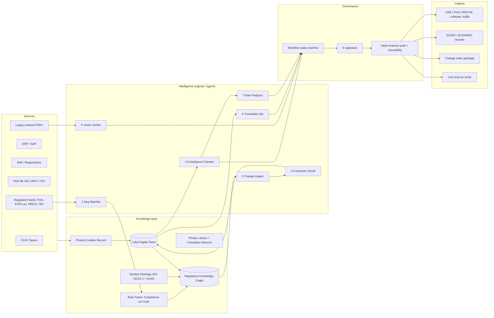

# 03 · Solution Blueprint: **LabelTwin**
### Label-as-Code: self-validating, traceable medical device labels
*Case Study 4 (HLS): End-to-End Labeling Automation Management for Medical Devices*

---

## 0. The one-paragraph pitch

Medical device labeling looks like a document problem, but it is really a **data-consistency problem**. Every label is a *view* computed from product data (PLM/ERP), market rules (EU MDR, FDA, ISO), language and packaging level. Errors happen because that computation is done by hand: people copy values between systems and re-read the same checklists hundreds of times.

**LabelTwin makes the computation explicit.**
- Each label becomes a **Label Digital Twin**: a structured object in which every element carries its *data source*, the *regulation that requires it* and the *risk it controls*.
- Regulations become **executable, versioned rule packs** (Compliance-as-Code).
- A **knowledge graph** links products, labels, markets and requirements, so one change instantly reveals every impacted label.
- **Generative AI and computer vision** are used only where the world is unstructured: reading regulations, reading artwork, drafting new text, checking translations. They work under a strict trust rule: **AI may add findings, never clear them.**

The result is labels that **prove their own compliance** and a review process where **humans handle only the exceptions**.

---

## 1. Problem reframing (what most teams will miss)

| Surface symptom in the case | Root cause | What LabelTwin does |
|---|---|---|
| Manual data entry, multiple sources of truth (pain points 1, 4) | Label values are *copied*, not *bound* to a golden record | Every element is **bound** to a source field. No free typing of controlled data. |
| Missed regulatory updates (2) | Requirements live in PDFs and in experts' heads | Requirements become **versioned rules** with effective dates. The watcher proposes rule changes. |
| Symbol errors (3) | Symbol applicability depends on market × device attributes × standard version | A **symbol ontology** (ISO 15223-1:2021 + Amd 1:2025) with applicability rules |
| Expertise dependency (5) | Knowledge is tacit | Rules carry their **rationale and citation**, so a junior engineer can see *why* |
| Manual redlining (6) | Comparisons are done by human eyes | **Vision diff** of approved vs revised artwork or print, with an auto-generated redline |
| Repetitive review (7) | The same 30 checks are repeated on every label | Deterministic checks run in **milliseconds**; humans review exceptions only |
| Traceability (8) | No machine-readable link from element → requirement → approval | A **graph path answers "Why is this here?"** for any element |
| Variant explosion (9) | Labels are hand-built per variant | Labels are **generated** from family × market × level × language matrices |
| Human error (10) | Copy/paste, outdated symbols, wrong revision | Binding + rules + vision verification + e-signed release gate |

> Key insight for the panel: *"We don't make reviewers faster at finding errors. We make most of the errors structurally impossible, then use AI to catch the rest."*

---

## 2. Current-state process map → Automation Opportunity Matrix

This follows the case's "Recommended Steps": Discover → Analyse → Innovate. Automation level: **A** = fully automated; **AI+H** = AI prepares and a human approves; **H** = human-only (by design).

| # | Traditional step (from the case) | Typical failure mode | LabelTwin lever | Target |
|---|---|---|---|---|
| 1 | Product / design information | Data scattered across PLM, ERP and specs | Connectors → **Product Golden Record** | A |
| 2 | Product understanding | Tacit knowledge; misread attributes | Attribute model (sterile? implant? latex? Rx? MRI?) drives rules | A |
| 3 | Identify applicable markets | Market list in spreadsheets | Market registry from RIM/ERP sales regions | A |
| 4 | Regulatory requirement assessment | Experts read regulations manually | **Rule packs** per market and standard version | A |
| 5 | Gap assessment | Manual compare vs requirements | Rule engine on the twin → gap list with citations | A |
| 6 | Identify labeling gaps | Missed gaps | Same, plus **graph impact** of changes | A |
| 7 | Gap addressal | Slow drafting | **GenAI Composer** drafts from an approved phrase library + RAG on IFU/risk file | AI+H |
| 8 | Label content development | Copy/paste errors | Elements **bound** to data; templates generate the content | A |
| 9 | Redline / artwork modification | Manual redline | **Auto-redline** (twin diff + vision diff) | A |
| 10 | Stakeholder review | Everyone reviews everything | **Risk-based, exception-only review** routing | AI+H |
| 11 | Regulatory / quality approval | Approval latency | E-signature (21 CFR Part 11 style) with full evidence pack | **H** |
| 12 | Label revision | Version mismatches | Twin versioning (semantic diff) | A |
| 13 | Change order creation | Manual CO paperwork | **Auto-drafted change order** with impact list and evidence | AI+H |
| 14 | Document / configuration control | Wrong revision released | Immutable, hash-chained audit trail; release gate | A |
| 15 | Final quality check | Visual inspection fatigue | **Vision verifier** on proofs and print samples, plus GS1 barcode verification | AI+H |
| 16 | Label release | Wrong variant released | Release only if all gates are green and the e-sign is present | A |
| 17 | Manufacturing | Label mix-ups on the line | Phone or line-camera **scan-to-verify** (DataMatrix ↔ twin) | A |
| 18 | Production implementation | No feedback loop | Findings feed the **risk predictor** and the rule-pack backlog | A |

**Future state:** 18 manual hand-offs collapse to **7 automated stages and 3 human decision points** (new content approval, final e-sign, exception disposition).

### Label-process FMEA (top items, to be quantified in Round 2)
| Failure mode | Effect | Current detection | LabelTwin control |
|---|---|---|---|
| Wrong expiry/lot in human-readable text vs barcode | Use of expired device; traceability loss | Visual check | Deterministic **HRI ↔ GS1 AI(17)/(10)** cross-check |
| Missing or wrong sterility symbol | Patient infection risk | Checklist | Attribute-driven symbol rule (sterile=true ⇒ method symbol) |
| Outdated symbol version | Notified-body observation | Expert memory | Symbol ontology versioning + Amd 1 rule |
| Translation alters a number (e.g. 37 °C → 73 °C) | Wrong storage or use | Native-speaker review | **Invariant check** (numbers, units, codes identical across languages) |
| EU label shipped in US carton (mix-up) | Non-compliant market release | Line inspection | Market-variant DataMatrix scan at line |
| Change made in PLM but not propagated | Silent non-conformity | None | **Graph impact + event trigger** |

---

## 3. Architecture



**Design principles**
1. **Deterministic core, probabilistic edge.** Rules and the graph decide. AI reads, drafts and flags.
2. **AI may add findings, never clear them.** A label passes only if every deterministic gate passes and a human signs. LLM output can only *raise* issues.
3. **Every output has provenance.** Each element, finding and decision links to a source, a rule citation and a signer.
4. **Tool-agnostic.** LabelTwin sits *above* the client's existing LMS (PRISYM 360, Loftware, Kallik, enLabel, BarTender) and PLM/ERP. This is how Tata Elxsi delivers services and accelerators.
5. **Human-in-the-loop by design, not by apology.** Humans own the three decisions that carry regulatory accountability.

---

## 4. Core data model: the **Label Digital Twin**

```json
{
  "twin_id": "LT-AFX-3018-EU-DE-UNIT",
  "version": "7.0.0",
  "product": {"family": "AeroFlow Coronary Stent System (fictitious)", "ref": "AFX-3018",
              "udi_di": "02000000301853", "class_eu": "III", "sterile": true,
              "sterilization": "EO", "implant": true, "rx_only_us": true, "latex": false},
  "market": "EU-DE", "packaging_level": "unit", "languages": ["de", "en"],
  "elements": [
    {"id": "E07", "type": "symbol+date", "symbol": "ISO15223-1:use-by-date",
     "value": "2028-03-31",
     "source": {"system": "PLM", "field": "shelf_life_months", "derive": "mfg_date + 36M"},
     "required_by": ["EU-MDR-AnnexI-23.2(i)"],
     "risk_control": "HAZ-014 use of expired device",
     "status": "PASS", "evidence": ["rule:EU-23.2i-USEBY", "rule:XCHK-HRI-AI17"]},
    {"id": "E11", "type": "udi_carrier", "symbology": "GS1 DataMatrix",
     "ai_string": "(01)02000000301853(17)280331(10)L24-0917",
     "required_by": ["EU-MDR-AnnexI-23.2(h)", "EU-MDR-Art27"], "status": "PASS"}
  ],
  "approvals": [{"by": "ra.reviewer@fictitious", "meaning": "Regulatory approval",
                 "at": "2026-11-29T10:41:00Z", "hash": "…"}]
}
```

> All product names and identifiers in the demo must be **fictitious**. The GTIN above uses the GS1 restricted-circulation prefix (02…) with a valid mod-10 check digit, so it can never collide with a real device. Use GUDID only to make attribute distributions realistic.

---

## 5. Compliance-as-Code: rule pack examples

```yaml
- id: US-801.18-DATE-FORMAT
  applies: {market: US}
  target: elements[type in (date, symbol+date)]
  check: regex(value, '^\d{4}-\d{2}-\d{2}$')
  severity: major
  citation: "21 CFR 801.18 (dates on labels as YYYY-MM-DD)"

- id: EU-23.2h-UDI-CARRIER
  applies: {market: EU-*}
  check: exists(udi_carrier) and gs1.gtin_check_digit_ok(udi.ai['01'])
  severity: critical
  citation: "Reg. (EU) 2017/745 Annex I §23.2(h); Art. 27; Annex VI Part C"

- id: XCHK-HRI-AI17
  applies: {market: any}
  check: gs1.date(udi.ai['17']) == element('use-by').value   # handles DD=00 → last day of month
  severity: critical
  citation: "GS1 General Specifications AI (17); label-internal consistency"

- id: US-801.109-RX
  applies: {market: US, when: product.rx_only_us}
  check: exists(text ~ 'Rx only' or text ~ 'Caution: Federal law restricts this device')
  severity: major
  citation: "21 CFR 801.109(b)(1)"

- id: EU-23.2q-MD-INDICATION
  applies: {market: EU-*}
  check: exists(symbol == 'ISO15223-1:medical-device')
  severity: major
  citation: "Reg. (EU) 2017/745 Annex I §23.2(q)"

- id: EU-ART10-11-LANGUAGE
  applies: {market: EU-*}
  check: required_languages(market) ⊆ twin.languages
  severity: critical
  citation: "Reg. (EU) 2017/745 Art. 10(11): Member State language requirements"

- id: ISO15223-AMD1-REP-SYMBOL
  applies: {market: EU-* | CH | UK}
  check: not uses_symbol_version('authorized-representative', '<Amd1:2025')
  severity: advisory      # transition depends on harmonisation status; RA decides
  citation: "ISO 15223-1:2021/Amd 1:2025 (authorized representative symbol generalised)"
```

Every rule has an **ID, scope, executable check, severity, citation, version and effective date**. Rule packs are versioned like software (semver, changelog, tests). This is what makes the system auditable.

> Verify clause numbers against the official texts before submission (EUR-Lex for MDR, eCFR for 21 CFR, and your library's copy of the ISO standards). ISO standard text is copyrighted, so reference clause numbers and do not reproduce the text.

---

## 6. The seven engines (each one is independently testable)

| # | Engine | Inputs → Outputs | Method | Deterministic baseline vs AI value | Human checkpoint |
|---|---|---|---|---|---|
| 1 | **Regulatory Watcher** | FDA Federal Register API, FDA guidance pages, EUR-Lex/OJ, MDCG docs, ISO catalogue updates → *proposed rule-pack diff* | Fetch → change-detect → LLM extracts obligations → maps to existing rules (RAG over rule library) | Keyword alerts vs **obligation-to-rule mapping** (measure precision/recall on a hand-labelled set of 30 updates) | RA expert approves every rule change |
| 2 | **Change Impact** | PLM change event or rule-pack change → impacted twins, markets, actions, effort, draft CO | **Graph traversal** (Neo4j): `Attribute→Element→Twin→Market`, `Rule→ElementType` | Fully deterministic. The LLM only writes the human-readable summary. | Labeling lead confirms scope |
| 3 | **Composer (GenAI)** | Golden record + rule pack + phrase library → new twin versions + rendered artwork | Template generation; approved phrases first; **LLM drafts only missing text**, grounded in IFU/risk file with citations | Approved-phrase reuse rate vs new-text rate (minimise new text) | New text always needs RA approval |
| 4 | **Compliance Checker** | Twin → findings with citations, confidence, evidence | **Tier 1:** rules (presence, format, GS1, consistency, symbol applicability). **Tier 2:** LLM cross-document checks (label warnings vs IFU contraindications, claims vs intended purpose). **Tier 3:** risk score. | Rules-only vs rules+LLM ablation on LabelBench | Exceptions only |
| 5 | **Vision Verifier** | Approved twin/PDF vs revised artwork, printer proof or phone photo → redline PDF + diff list | Vector PDFs: PyMuPDF exact text + positions. Raster: ORB alignment → OCR (PaddleOCR) → token diff; symbol detection (template matching → small detector); **barcode decode + GS1 parse + HRI cross-check**; SSIM layout heatmap | Pixel diff baseline vs **semantic diff** (fewer false alarms) | QA dispositions flagged diffs |
| 6 | **Translation QA** | Source + target texts → issues | **Invariants** (numbers, units, temperatures, dates, REF/LOT, symbols identical), termbase consistency, back-translation + multilingual embedding similarity (bge-m3/LaBSE), LLM meaning-drift explanation, text-overflow check | Invariants catch number errors 100% of the time; the LLM explains subtle meaning drift | Linguist reviews only flagged segments |
| 7 | **Risk Predictor** | Twin features (markets, languages, manual fields, change frequency, new-text ratio, implant/sterile, past findings) → risk score → review depth | Rule-weighted score now; gradient-boosted model once history exists; priors from **FDA labeling-recall mining** | Static "review everything" vs **risk-based review** (in the spirit of FDA's Computer Software Assurance guidance) | High-risk labels get two-person review |

**Stretch (finale wow):** a **phone scan-to-verify** web page (camera + `@zxing/browser`). Point the phone at a printed label and it decodes the DataMatrix, fetches the twin and shows ✅/❌ in under a second. Live on stage.

### "Agentic" done responsibly
The case's "Agentic AI Labeling Ecosystem" vision maps onto engines 1–7 as **agents with bounded tools**. They are coordinated by a **deterministic workflow state machine** (`DRAFT → AUTO_CHECKED → IN_REVIEW → APPROVED → RELEASED → SUPERSEDED`), not by a free-running LLM loop. Agents propose; gates and humans dispose. Say this sentence in the finale. It is exactly what a regulated-industry panel wants to hear.

---

## 7. Trust, compliance and validation of the tool itself

| Concern | Design answer |
|---|---|
| **21 CFR Part 11** (electronic records and signatures) | Unique user IDs, RBAC, e-signature bound to the record with signer, time and **meaning** (review / approval / responsibility); append-only audit trail; **SHA-256 hash chain** for tamper evidence |
| **FDA QMSR** (in force 2 Feb 2026; §820.45 labeling and packaging controls retained) | Release gate enforces label inspection and approval records before release |
| **ISO 13485 / ISO 14971** | Every warning element links to its hazard ID in the risk file ("information for safety" as a risk control) |
| **Tool validation** (GAMP 5 / CSA) | Risk-based testing of rule packs (unit tests per rule), golden-set regression (LabelBench) on every release |
| **Data privacy and IP** | **Local LLM option** (Ollama/vLLM on-prem). Product data never leaves the client tenant. |
| **Hallucination** | LLMs never generate controlled data (UDI, dates, lot, REF), never clear findings, and every LLM claim carries a source span |
| **EU AI Act** | LabelTwin is a QMS tool, not a medical device. It also ships a rule pack that checks **AI-transparency statements in IFUs** for clients that make AI-enabled devices. |
| **Licences** | Prefer permissive (Apache/MIT/BSD) dependencies, because submissions become Tata Elxsi IP. Avoid AGPL in the core. ISO symbol graphics need licensing for production. |

---

## 8. Validation approach: **LabelBench** (your biggest differentiator)

No public labeling-QA benchmark exists, so **build one and publish its results**.

1. **Corpus:** 4 fictitious device families (sterile Class III coronary stent; reusable surgical instrument; Class IIb orthopaedic screw; non-sterile Class I device) × 5 markets (US, EU-DE, EU-FR, UK, CH) × 3 packaging levels ≈ **60 twins / 120+ label-language artifacts**. Use **AccessGUDID** to make attributes realistic.
2. **Defect taxonomy derived from FDA recall data.** Pull labeling-related recalls from openFDA (`tools/fda_labeling_recall_miner.py` in this repo) and cluster the reasons into **~20–25 failure modes**: wrong expiry, wrong lot, HRI≠barcode, wrong GTIN check digit, missing sterile symbol, wrong sterilisation method, missing Rx only, missing MD, missing market language, translation number change, outdated symbol, wrong manufacturer address, EU/US variant mix-up, text overflow, contradictory warning vs IFU, and so on.
3. **Seeded-defect injection** with a generator: N defects per type, randomised, with ground truth recorded.
4. **Metrics:** per-defect **recall and precision**, false alarms per label, time-to-assess a change, % of checks automated, % of elements with full provenance.
5. **Ablation:** rules-only vs LLM-only vs **hybrid**. Expected outcome: the LLM alone misses deterministic errors (check digits, date formats) and rules alone miss semantic ones (warning contradicts IFU), so the hybrid wins.
6. **Mini user study:** 6–10 classmates review 10 labels with a printed checklist vs with LabelTwin, timed and scored. Report **minutes per label and defects caught**. Real evidence beats claims.

**Targets to state in Round 1** (to be proven in Round 2): ≥95% recall on critical seeded defects; change-impact assessment from days to **minutes**; ≥70% of repetitive checks fully automated; 100% element-level traceability.

---

## 9. Demo scenarios (use all three in Round 2 and the finale)

1. **Product change:** shelf life changes from 24 → 36 months in PLM. The impact graph lights up every affected twin across markets and packaging levels, plus the GUDID/EUDAMED records and the IFU section. Twins regenerate, all checks run, and **only 2 exceptions reach humans**: new German stability text (LLM draft with citation) and a Japanese text overflow.
2. **Regulation change:** the watcher ingests **ISO 15223-1 Amd 1:2025** (authorised-representative symbol generalised). It proposes a rule-pack diff, the RA expert approves, the impacted labels are flagged and auto-redlined, and a change order is drafted.
3. **Print verification:** a printed proof is held to a phone. The system flags that the **DataMatrix AI(17) expiry ≠ printed expiry**, generates the redline PDF and blocks release. Then click **"Why is this here?"** on the LOT symbol to show the full trace path to EU MDR §23.2(g), PLM lot control and the approver's e-signature.

---

## 10. Business case (illustrative: state your assumptions)

- The case's own numbers: **1 product change → 30+ labels × 20+ languages = 600+ label-language artifacts** to update and verify.
- Example model for a mid-size manufacturer: 800 label revisions/year × 12 person-hours each × blended $55/h ≈ **$528k/year** of labeling effort. A **50% reduction ≈ $264k/year**, before counting avoided launch delays, rework, scrap and recall exposure. *These are assumptions. Show the formula and let the panel change the inputs live.*
- **Tata Elxsi go-to-market:** an accelerator attached to their existing labeling services, LMS implementation and EU MDR/EUDAMED remediation work (the same pattern as RegAI). It also lifts **their own delivery margins** by making offshore labeling teams faster.

## 11. Scaling path

| Dimension | Prototype | Production |
|---|---|---|
| Labels | ~60 twins | 10k–100k twins; incremental re-evaluation (only graph-affected twins re-checked) |
| Markets | 5 | Rule packs per market as versioned, tested artifacts (marketplace model) |
| Compute | Laptop + Docker Compose | Kubernetes; LLM gateway (on-prem vLLM or client-tenant cloud LLM) |
| Integration | CSV/JSON mocks | Windchill/Teamcenter, SAP, PRISYM/Loftware/Kallik APIs, GUDID (HL7 SPL) and EUDAMED (XML/M2M) submissions |
| Users | Single tenant | Multi-tenant, SSO (Keycloak/Entra), RBAC, data residency |

## 12. Tech stack

| Layer | Prototype choice (free) | Why |
|---|---|---|
| API / services | Python 3.11, FastAPI, Pydantic | Fast to build; typed models for the twin |
| Graph | Neo4j Community (or NetworkX fallback) | Impact traversal, traceability paths, great visual demo |
| Rules | YAML DSL + Python evaluator (OPA/Rego in production) | Readable by RA staff; unit-testable |
| Storage | PostgreSQL (+ pgvector) | Twins, audit chain, embeddings in one DB |
| LLM | Ollama + Qwen3-8B / Llama-3.1-8B (local); hosted API only with fictitious data | Privacy story; zero cost |
| Embeddings | bge-m3 (multilingual) | 20+ languages |
| Documents | PyMuPDF (vector PDF text + coordinates) | Exact text, no OCR errors on digital artwork |
| OCR / CV | PaddleOCR, OpenCV (ORB, SSIM) | Multilingual OCR; alignment; diff heatmaps |
| Barcodes | zxing-cpp (decode), BWIPP via treepoem or zint (encode), own GS1 AI parser (~150 lines) | GS1 DataMatrix / GS1-128 |
| Rendering | Jinja2 → SVG/HTML → PDF (WeasyPrint) | Deterministic artwork from the twin |
| Front-end | React + Vite + TypeScript + Tailwind; Cytoscape.js (graph); pdf.js (redlines) | Design-led UI (Tata Elxsi is a design company) |
| Phone scan | `@zxing/browser` web page | Live finale demo |
| Ops | Docker Compose, GitHub Actions running rule tests + LabelBench | Shows MLOps/QA maturity |

## 13. Risks and mitigations

| Risk | Mitigation |
|---|---|
| Scope creep (10 suggested approaches) | Build the **spine** first (twin → rules → impact → checker → audit), then vision, then translation, then watcher |
| LLM hallucination | Asymmetric trust rule; citations required; controlled fields never LLM-generated |
| No real client data | LabelBench + GUDID realism + FDA recall-derived defects; be explicit that the data is synthetic |
| Regulatory misquotes | Every rule cites a clause; one teammate owns citation verification |
| Demo failure | Recorded backup video; offline mode; seeded scenarios scripted end-to-end |

## 14. Coverage of the case's evaluation criteria

| Criterion (from the case) | Where LabelTwin shows it |
|---|---|
| Understanding of labeling problem | §1 reframing, §2 process map + FMEA |
| Regulatory / compliance awareness | §5 rule packs (MDR §23.2, 21 CFR 801/830/11, QMSR, ISO 15223-1 Amd 1, ISO 20417:2026, GS1), §7 |
| Innovation in label design using AI | Label Digital Twin, Composer, asymmetric trust, "Why is this here?" |
| AI / automation platform | §3 architecture, §6 engines, §12 stack |
| End-to-end process coverage | §2 matrix: all 18 steps mapped |
| Accuracy and validation approach | §8 LabelBench, ablation, user study |
| Traceability and auditability | Twin provenance, graph paths, hash-chained audit, e-sign |

The case's **10 potential approaches** are all covered: (1) Composer, (2) Checker, (3) Impact, (4) Vision, (5) Watcher, (6) Translation QA, (7) prompt-to-change, via Composer + workflow, (8) Risk Predictor, (9) phone scan-to-verify as a lightweight AR precursor, (10) agents under a deterministic orchestrator.

## 15. Regulatory references (read these)

- EU MDR 2017/745 (consolidated): <https://eur-lex.europa.eu/legal-content/EN/TXT/?uri=CELEX%3A02017R0745-20230320>. Annex I Chapter III §23, Art. 10(11), Art. 27, Annex VI.
- FDA general device labeling: <https://www.fda.gov/medical-devices/device-labeling/general-device-labeling-requirements>; eCFR 21 CFR Parts 801, 830, 820 (QMSR) and 11.
- 21 CFR 801.18 date format: <https://federal-regs.com/title/21/part-801/801.18/>
- FDA UDI form and content guidance: <https://www.fda.gov/regulatory-information/search-fda-guidance-documents/unique-device-identification-system-form-and-content-unique-device-identifier-udi>
- AccessGUDID APIs (device lookup, Parse UDI): <https://accessgudid.nlm.nih.gov/resources/developers/v3/parse_udi_api>
- openFDA device recall endpoint: <https://open.fda.gov/apis/device/recall/>
- EU UDI: <https://health.ec.europa.eu/medical-devices-topics-interest/unique-device-identifier-udi_en>
- EUDAMED mandatory timeline: <https://www.tuev-nord.de/en/knowledge/standards-in-focus/eudamed-mandatory-use-of-first-four-modules-from-may-28-2026/>
- ISO 15223-1:2021 (+Amd 1:2025): <https://www.iso.org/standard/77326.html>; ISO 20417:2026: <https://www.iso.org/standard/88714.html>
- IMDRF N52 principles of labelling: <https://www.imdrf.org/documents/principles-labelling-medical-devices-and-ivd-medical-devices>
- QMSR overview: <https://www.greenlight.guru/blog/21-cfr-part-820>
- Tata Elxsi whitepaper on EU MDR labeling (**read it and quote it**): <https://www.tataelxsi.com/storage/insights/November2022/Tata-Elxsi-Whitepaper-Impact-of-EU-MDR-on-Medical-Device-Labeling.pdf>
- Competitive landscape: GlobalVision Verify CheckAI <https://www.globalvision.co/solutions/labeling-quality-control>, Kallik <https://www.kallik.com/blog/medical-device-regulations-2026-labeling-packaging-guide>, Loftware <https://www.loftware.com/industries/medical-device>. **Our gap:** incumbents verify artwork or manage templates. None ties PLM change → regulation → label element → approval in one traceable graph with executable rules.
