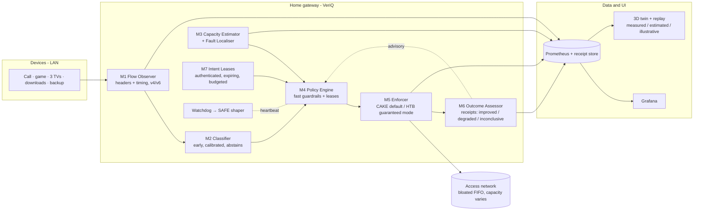

# 05 · Case 3 Solution Blueprint: **VeriQ** (v3.1)
### Finds the cause, protects what you chose, and proves it
*Intent-aware home QoS with measurable outcomes, bounded adaptation and explainable recovery*
*Case Study 3 (MCV): Adaptive QoS Engine for Mixed Home Broadband Traffic*

> **v2 changes (after external review).** We merged the strongest engineering safeguards of the "IntentGuard" proposal into VeriQ and narrowed every claim we cannot prove. Main changes:
> 1. Outcome checks now return **improved / degraded / inconclusive**, and causal claims come only from controlled repeated experiments.
> 2. **Real bandwidth floors** come from an HTB hierarchy; CAKE tins alone only give priority sharing.
> 3. **Fault localisation** runs before any action.
> 4. Conformal prediction is reported correctly: coverage, selective accuracy and abstention.
> 5. The quality score (MOS) is labelled *estimated*; endpoint freeze and rebuffer counts lead.
> 6. The privacy statement is precise.
> 7. Baselines are the **real, tuned** tools, plus ablations.
> 8. A scope split separates the **MVP spine** from **stretch tracks**.
>
> **v2.1 (12 Oct 2026)** adds lessons from a competing team's public prototype (see `docs/07_Competitor_Analysis_AQE.md`). These are **ideas only, no code**:
> 1. Active packet-train capacity probing (SLoPS, Jain & Dovrolis 2002) for idle links.
> 2. An estimator ground-truth test matrix E1–E8.
> 3. An evidence ledger and a CI claims check.
> 4. A requirement traceability matrix.
> 5. A fault-injection script and a discrepancy log.
> 6. Deployment hygiene (systemd, install/verify/reset, netns-vs-real-NIC backend).
> 7. Concrete API authentication.
>
> **v3.1 (12 Oct 2026): locked core + verified upgrades.** The v2.1 core is **locked**: CAKE default, HTB lease mode, the fault localiser, three-speed receipts and honest statistics. The best parts of the v3 research pass are added **with six corrections applied**. Full decision log: `docs/08_VeriQ_v3.1_Decisions.md`.
>
> *Added to the core:*
> 1. Marks-first classification (NQB DSCP 45 / L4S ECT(1)) with a behaviour check.
> 2. The classifier "honesty kit" (per-flow and per-time splits, no shortcut features).
> 3. Fast-detector starting values from cake-autorate's published defaults.
> 4. A **bounded fallback action** when the diagnosis is uncertain.
> 5. A UDPST (RFC 9946) idle-capacity probe.
> 6. Shadow (dry-run) mode, a per-decision log, health states and retry with backoff.
> 7. RPM bands.
> 8. **QoO scores computed offline** from harness data.
> 9. Harness-first build order and a tiered run matrix.
>
> *Moved to post-core experiments:* the NQB lane, DualPI2, the header-only call-quality estimator, live QoO in receipts, and the chat box.
>
> Everything below is a **design with targets, not measured results**, until the lab produces them.

---

## 0. The idea in one paragraph

VeriQ is a home-gateway QoS controller with **three loops running at different speeds**:
1. **Fast guardrails** (sub-second) track link capacity and keep queuing delay bounded.
2. A **medium-speed outcome check** (tens of seconds) attaches an *experience receipt* to every adaptation. Each receipt says whether the change **improved**, **degraded** or was **inconclusive** for real application metrics, and explains why.
3. **Slow, controlled experiments** (lab, repeated and randomised) are the *only* source of causal performance claims.

Before acting, VeriQ **localises the fault**: our own queue, the WAN capacity, the remote path, Wi-Fi, or a misleading measurement. It then uses the action that fits that fault. Temporary user intents become **authenticated, expiring leases** paid from an explicit **promotion budget**, enforced by real guaranteed rates.

> Pitch line: **"VeriQ adapts, measures, and explains: every decision comes with evidence, and every claim with a method."**

---

## 1. Why the obvious solutions fail

| Generic approach | Why it fails in a real home |
|---|---|
| Static priority by port/DSCP | Most apps use QUIC/TLS on 443; many endpoints don't set DSCP; ports don't tell you what matters *now* |
| "AI classifier + priority queue" | Prioritising does nothing if the queue sits in the ISP modem. The gateway must become the bottleneck by shaping just below the true capacity. |
| Fixed shaper at 90% of plan speed | Capacity moves (DOCSIS, 5G FWA). Too high and the bloat returns; too low and bandwidth is wasted. |
| Strict priority | Starves bulk traffic, which the case forbids |
| Chatbot intents | The case requires AI to improve a measurable outcome, not to add chat |

**Day-0 evidence:** our lab (`lab/quickstart_bufferbloat.sh`, emulated 20/5 Mbit with a 300 ms ISP buffer) measured **266 ms p95 added delay on upload with a stock FIFO**. **fq_codel without a shaper is not a fix**: it cannot touch a queue that lives upstream.

---

## 2. Architecture

---

## 3. Modules: contracts

### M1 · Flow Observer
- **In:** packets on the LAN/WAN interfaces (IPv4 + IPv6).
- **Out:** per-flow records: 5-tuple; first-N packet sizes, directions and inter-arrival times; rates; burst structure; DSCP/ECN bits; TCP handshake RTT.
- **Implementation:** **MVP** uses userspace AF_PACKET capture of headers only, to get features working fast. **Stretch** ports it to eBPF on `tc clsact` for CPU efficiency, and keeps the port only if CPU measurements justify it.
- **Precise privacy statement:** VeriQ **does not inspect the payload of forwarded traffic** and does not decrypt anything.
  - Tier 0 (default) uses headers and timing only.
  - Tier 1 (household opt-in, local only) additionally uses **the gateway's own DNS and DHCP service records** for device and service hints. That is information the gateway already holds as a service provider, and the UI discloses it.
  - Accuracy is reported **per tier**.
- **Failure handling:** feature buffer overflow → oldest flows evicted and counted.

### M2 · Flow Classifier
- **Classes:** `REALTIME`, `GAMING`, `STREAMING`, `INTERACTIVE`, `BULK_DOWN`, `BULK_UP`, `UNKNOWN`.
- **Model:** a **small calibrated gradient-boosted model first**, evaluated after 5/10/20/30 packets (early classification). Add a 1D-CNN (and distillation) **only if an ablation shows it earns its cost**.
- **Abstention:** split-conformal prediction sets. Act only on **single-class sets**; anything else → `UNKNOWN` (best effort, never promoted).
- **Reported separately, never conflated:**
  1. empirical **set coverage** on held-out data (the conformal guarantee is about sets, under exchangeability);
  2. **selective accuracy**, i.e. accuracy of the single-class predictions we act on;
  3. **abstention rate**;
  4. per-class recall;
  5. all of the above **under shift**: different days, app versions and household mixes;
  6. how the earliest confident prefix was selected (on validation data, never on test).
- **Data:** independently labelled **household workloads** from our lab apps are the primary data. **CESNET-QUIC22** (153M QUIC flows, 102 service classes) is a *secondary* benchmark, with a documented service → category mapping and feature-compatibility notes. Its service labels do not directly say whether traffic needs interactive protection.
- **Correction loop:** a user relabel becomes an override rule plus a labelled sample (audit-logged).
- **Baselines:** port/protocol rules, **and qosify-style heuristics** (small-packet boost, bulk detection by packet rate). This is the strongest simple rival.
- **Marks first (v3.1).** VeriQ reads the DSCP and ECN bits the app set.
  - **DSCP 45** (NQB, RFC 9956) or **ECT(1)** (L4S) counts as a *hint*, trusted only while the flow behaves: low rate (roughly ≤ 1% of capacity for NQB) and not building a queue.
  - A marked flow that misbehaves is treated as unmarked.
  - Only unmarked flows go to the classifier. This answers the operator view (e.g. Comcast's 2026 deployment draft) that apps should mark rather than networks guess.
- **What a singleton conformal set means:** VeriQ *acts* only on a single-class set. That is a rule for when to act; it does **not** claim the label is correct. Correctness is reported separately as selective accuracy.
- **Honesty kit (v3.1).** Lesson from SIGCOMM 2025, "The Sweet Danger of Sugar": leaky splits inflated famous encrypted-traffic results, and shortcut features collapse under realistic tests.
  - Split **by flow** (never by packet) and **by time** (train earlier, test later).
  - **Hold out whole apps**, to test abstention.
  - **Remove** IP addresses, ports, TTL, TCP sequence/ack numbers and timestamps from the features.
  - Report **macro-F1** next to accuracy.
  - Run an **occlusion test** (drop one feature group at a time). A collapse is a *lead to investigate* for a shortcut, not proof of one.

### M3 · Capacity Estimator + **Fault Localiser**
**Signals:**
- our own qdisc backlog, drops and ECN marks;
- throughput;
- one-way-delay probes to **two tiers of reflectors**: the ISP first hop or near reflector, and several far reflectors;
- passive TCP handshake RTT;
- Wi-Fi station stats where available (retries, MCS/rate, airtime).

**Estimation:** state-space filter on capacity, plus change-point detection on delay and delivery rate. Output: capacity μ ± σ per direction.

**Active probing (v2.1).** Delay-based tracking is blind on an **idle** link: no traffic, no signal. VeriQ adds a short **SLoPS-style packet-train probe** (Self-Loading Periodic Streams; Jain & Dovrolis, 2002, the *pathload* method) towards an **operator-hosted reflector**. It sends paced streams at trial rates and checks whether one-way delays trend upward, which brackets the available bandwidth. Rules:
- **When it runs:** at start-up, after a suspected change, and periodically at a low duty cycle. It never runs while a call is active unless capacity is unknown.
- **Overhead:** probe traffic is measured and reported.
- **No reflector available:** passive tracking only, and the estimate is marked as such.
- **Pacing:** in C or the kernel for production, because user-space pacing jitters.

**Estimator ground-truth tests:**

| ID | Test | Checks |
|---|---|---|
| E1 | Static 100 Mbps | Steady-state accuracy |
| E2 | Static 20 Mbps | Steady-state accuracy |
| E3 | Drop 100 → 20 | Settle time from the drop event |
| E4 | Recovery 20 → 100 | Upward probing speed |
| E5 | Bursty cross-traffic | Robustness to competing load |
| E6 | Many concurrent flows | Robustness under heavy use |
| E7 | Remote-path delay | Must **not** cut the shaper |
| E8 | Lying reflector | Must be ignored |

Each test reports relative error, whether the [μ−2σ, μ+2σ] range contains the true value, settle time measured **from the injected event**, and probe overhead.

**Fast detector: starting values (v3.1).** VeriQ starts from **cake-autorate's published defaults** and tunes them in the lab. It does not invent constants:
- per-reflector baselines that rise very slowly and fall fast;
- "delayed" = more than about 30 ms above baseline;
- bufferbloat flagged when **3 of the last 6** samples are delayed;
- cut by up to ×0.75, raise by ≤ ×1.04 only under high load and low delay;
- refractory periods (≈ 300 ms after a cut, ≈ 1 s between drifts);
- probe sleep when idle.

The difference from cake-autorate: a *confirmed* WAN diagnosis allows the full cut, and a *remote* diagnosis holds.

**How the probes relate (corrected in v3.1).** The near-hop and far-reflector round trips are **overlapping observations, not independent legs**: a far RTT *contains* the access link and the near hop. VeriQ therefore never adds segment delays together (percentiles do not add anyway). It compares **patterns of change** against each probe's own baseline:
- near and far rising together, with our queue empty, points to the access link;
- far rising alone points beyond it.

The router's own queue delay comes from qdisc statistics, which *are* separately observable. Wi-Fi delay is only visible from client-side measurements or driver statistics, so router-originated probes say nothing about the Wi-Fi hop.

**Bounded fallback when the diagnosis is uncertain (v3.1).** "Cut only when WAN is confirmed" would leave real congestion untreated whenever the evidence is ambiguous. So if bufferbloat is detected but the localiser is uncertain, VeriQ:
1. applies **one small, bounded cut** (≤ 10% of the shaper);
2. holds for one refractory period;
3. records `diagnosis=UNCERTAIN, action=bounded_fallback`.

It keeps the cut only if queuing delay improves, and reverts otherwise. Repeated uncertainty raises an alert instead of cutting again and again.

**Idle-capacity probe (v3.1): UDPST first.** The preferred probe is the **UDP Speed Test protocol (RFC 9946, April 2026)**, the protocol behind the Broadband Forum's TR-471 IP-layer capacity test. TR-471 is modelled in TR-181 as `Device.IP.Diagnostics.IPLayerCapacityMetrics`, which an operator can trigger remotely. SLoPS remains an alternative method.
- **Both** need a cooperating server, so neither is a fallback for the other's missing server.
- With no server, VeriQ tracks passively and labels the estimate as passive.
- Probes never run during an active call lease, and are capped in size.

**Fault localisation runs before any action:**

| Evidence | Diagnosis | Action |
|---|---|---|
| Our queue grows, external delay flat | Gateway is the bottleneck (healthy) | Nothing; the AQM handles it |
| Our queue empty, near **and** far delay rise | **WAN capacity dropped** | Cut the shaper (fast path), re-probe upward slowly |
| Only far reflectors rise, near hop fine | **Remote path** congestion | **Hold the shaper**; cutting it would waste capacity |
| WAN fine, Wi-Fi retries/airtime spike for a station | **Wi-Fi** bottleneck | Don't touch the WAN shaper; flag it (Phase 2: airtime weights) |
| One reflector disagrees with the others | **Misleading measurement** | Down-weight it via reflector health voting; no action |
| Contradictory or low-confidence evidence | **Unknown** | Conservative hold + alert |

Every diagnosis carries a confidence, and it is evaluated in the lab against the emulator's **ground truth**.

### M4 · Policy Engine (fast guardrails)
- Shaper rate = μ − kσ, so uncertainty buys margin.
- Bounded AIMD with a change-point fast path for drops; slow upward probing.
- Rate-of-change limits and hysteresis on class changes.
- **States:** `INIT → LEARN → STEADY ⇄ ADAPTING → STEADY`. Invariant violation → `SAFE`.
- **Decisions never depend on the slow outcome check to stay safe.** Guardrails act immediately; receipts explain afterwards.

### M5 · Enforcer: two modes with honest semantics
1. **Default mode: CAKE** (`diffserv4`, per-host fairness, overhead compensation). This gives **bounded preferential treatment** (priority sharing with tin thresholds), **not hard minimum rates**. Fairness is *measured*.
2. **Lease mode: HTB hierarchy** under the shaper. This is what gives **real minimum rates** while intents are active. The tree is specified exactly (v3.1):
   - parent class `rate = ceil = S` (the shaper rate);
   - **one Default class**: `rate = S − ΣL`, `ceil = S`, with fq_codel inside;
   - **one class per granted lease *i***: `rate = Lᵢ`, `ceil = S`, with fq_codel inside;
   - **budget invariant: ΣL ≤ 0.6·S**, so Default always keeps a guaranteed `rate ≥ 0.4·S`;
   - **when S shrinks** (e.g. a WAN drop), all lease rates are rescaled proportionally to restore the invariant, and lease holders are told their rate dropped;
   - a device gets **at most one lease class**, so overlapping requests are merged;
   - a filter maps the device's traffic to its lease class; everything else goes to Default.

   Admission control grants, part-grants or refuses each request against the budget, and gives the reason. Weighting *within* each class is done by fq_codel, so no HTB "equal weight" feature is needed. Mode switches (CAKE ↔ lease tree) follow the ordered-apply rules below.

**Apply semantics (narrowed):**
- Multi-step netlink updates are **not atomic**. Updates are **ordered so every intermediate state is safe**: change rates before removing classes, add filters after classes exist.
- Each update is versioned, read back and **compensated** on mismatch.

**DSCP and ECN (wording corrected in v3.1):**
- VeriQ classification sets `skb->priority` or firewall marks and **does not rewrite DSCP**.
- VeriQ itself sets no ECN bits. However, its AQMs (CAKE, fq_codel) **mark ECN-capable packets CE** as their normal congestion signal instead of dropping them. That is ECN working as designed, not a rewrite of the app's intent.
- DSCP that apps set themselves passes upstream **unless `wash` is enabled**, which is configurable and documented.

**SAFE profile:** a static conservative CAKE shaper at last-known-good capacity minus margin. This is not plain fq_codel, which cannot fix an upstream bottleneck. Fallback time is a **measured target**, not a promise.

### M6 · Outcome Assessor ("experience receipts")
**Metrics (in priority order):**
1. **Endpoint-measured:** WebRTC `freezeCount`, `totalFreezesDuration`, `concealedSamples`, jitter-buffer delay; DASH rebuffer events and bitrate switches.
2. **Network-measured:** queuing delay percentiles, loss, goodput per class and host, **progress per class** (starvation is measured as zero useful progress over a window, not inferred from config).
3. **Modelled:** *estimated* audio quality via the ITU-T G.107 E-model, which is a planning model. The codec and impairment assumptions are documented and the result is always labelled "estimated".
4. **RPM** (IETF responsiveness draft-09, a work in progress) is run as a **scheduled** benchmark, never as a hidden load during someone's call.

**Receipt logic (operational, not causal):**
- Compare windows only **within a stable regime**. If a capacity change-point, demand shift or another policy change falls inside the window, the result is **inconclusive**, never "degraded".
- Use block bootstrap (observations are autocorrelated) and minimum sample counts.
- On **degraded**, the rollback **reverts the policy delta re-derived for current conditions**. It never restores a stale absolute rate from a different capacity regime.
- Receipts are **advisory**. Safety comes from the guardrails, not from statistics.

### M7 · Intent Leases
- A lease looks like `{who (authenticated), target device/class, goal, ttl, budget_share}`.
- A **promotion budget** sets the maximum total guaranteed share all leases may hold, implemented as HTB guaranteed rates. Admission control decides grant / partial grant / deny, and gives the reason.
- Leases always expire; renewing requires re-authentication.
- Conflicts resolve as safety > household rules > priority > age.
- **User corrections and overrides pass the same checks** (budget, protection, schema) as new leases. A correction can never bypass the budget.
- **Interfaces:** REST + UI. A TR-181-style data-model / TR-369 USP mapping is **designed, not implemented** in the MVP.
- **API security:** token auth with constant-time comparison, binding to loopback/LAN only by default, rate limits, and an append-only audit log of every lease decision. Example credentials in the repo are clearly fictitious.

### M8 · Telemetry, Grafana and the **3D twin with replay**
- Every visual element carries one of **three encodings**:
  - **Measured** (solid): local queue counters, throughput, endpoint stats.
  - **Estimated** (outlined + confidence band): capacity, inferred upstream congestion, diagnosis.
  - **Illustrative** (particles, house graphics): labelled as such.
- The **ISP queue tank is "inferred"** (hatched), because a gateway cannot observe it. In the lab, the emulator's **true** queue is shown beside the inferred one. That makes estimator accuracy itself visible.
- **Replay scrubber:** select the moment capacity collapsed, and call metrics, queues, estimator confidence, diagnosis, applied config and the receipt move together.

### M9 · Evidence Harness
- **netns lab + scenario YAML:** timed capacity steps, traffic starts and **fault injections** (capacity drop, remote-path delay, lying reflector, Wi-Fi-like station impairment, controller crash).
- **Real apps:** WebRTC between headless Chromium instances (ffmpeg test-pattern media), dash.js with locally encoded DASH, tick-based game traffic, iperf3/HTTP bulk in both directions.
- **Arms (real, tuned implementations):**
  1. stock FIFO;
  2. fq_codel;
  3. OpenWrt-style **SQM CAKE** (static, tuned);
  4. **cake-autorate v3.2** (the actual project, tuned per its docs);
  5. VeriQ.
- **Ablations:** VeriQ without the classifier, without fault localisation, and without the HTB guaranteed mode. **This proves VeriQ is more than a CAKE wrapper, or tells us honestly where it isn't.**
- **Statistics for claims:** ≥10 runs per arm per scenario in **randomised order**; medians with bootstrap 95% CIs; Holm correction across metrics; an environment fingerprint on every report.
- **Evidence ledger (v2.1):** each run stores raw files plus a manifest (scenario, arm, seed, config hash, git commit, kernel and tool versions). Reports are generated **only** from the ledger.
- **Claims check in CI:** a script recomputes every number used in the README and slides from raw data, and fails CI if any is not reproducible within tolerance.
- **Requirement traceability matrix:** `docs/traceability.md` maps each Case 3 requirement → module → test → evidence file.
- **Fault injection + discrepancy log:** `inject_fault.sh` covers WAN drop, remote delay, lying reflector and controller kill. `docs/discrepancies.md` records every result that differed from expectation, and why.
- **Direction pitfall:** `tc` shapes egress only. Download shaping sits on the LAN-facing egress (or IFB on WAN ingress), and every test asserts that its flows cross the shaped interface.

---

## 3A. v3.1 additions to the core

### Safety supervisor: shadow mode, decision log, health states
- **Health states:** `SHADOW` (dry-run) → `LIVE` (only after a person approves) → `DEGRADED` (any error) → `SAFE` (the watchdog's fixed shaper) → back to `SHADOW` after a self-check passes. `DISABLED` means **clean up**: restore the configured rates, remove VeriQ's overrides, report "disabled".
- **Shadow mode:** the whole loop runs, but the Enforcer only *writes what it would do*. Demo line: "VeriQ ran in shadow for an hour before it was allowed to touch the queue."
- **Decision log:** one row per decision, **including "do nothing"**. Columns: time, state, direction, shaper, achieved rate, own-queue delay, near/far probe deltas, diagnosis + confidence, candidate action, target, reason, blocker, outcome (`applied / shadow / skipped / failed`), lease ids.
- **Retries:** a failed apply does not start the cooldown. It retries with **exponential backoff** (with a cap), then drops to `DEGRADED`.
- **What shadow mode can and cannot prove:** running VeriQ in shadow beside cake-autorate gives a **disagreement report** (when and how their decisions differ). Nobody knows what would have happened in a real home, so shadow logs **cannot count "avoided wrong cuts"**. Whether a disagreement was right is judged **only in the lab**, where the injected fault is known.

### QoO scoring: offline first
VeriQ computes **Quality of Outcome** scores (IETF `draft-ietf-ippm-qoo-11`, May 2026, still a draft) **offline from data the harness already measures**. This keeps the IETF-aligned story without risking the live loop.
- **How it works:** per class, two requirement profiles: "works perfectly" and "unusable". Each profile gives delay at chosen percentiles, a loss ratio and a minimum throughput. Each measured percentile is placed on a 0–100% scale between the two profiles, and the class score is the worst of these.
- **Measurement rules (v3.1 corrections):**
  1. **Same statistic on both sides.** A p95 requirement is compared with a measured p95, never with an added-delay p95 or a p99.
  2. **Sample-size floor.** Enough samples for the percentile: p95 needs ≳ 100 and p99 needs ≳ 1,000 samples in the window. **p99.9 is not reported** unless there are ≳ 10,000. Otherwise the score is "insufficient data".
  3. **Coverage label.** Every score states the path it covers. Router → reflector probes exclude the Wi-Fi hop; harness client probes include it.
  4. **Throughput minimum** is judged only when the app *wanted* that rate (demand ≥ the minimum). For a quiet, app-limited flow it is "not assessed", because a quiet app says nothing about the line's capacity.
  5. **Metadata on every score:** method, probe size, rate (≥ 10 Hz), path, direction, start, duration, sample count.
- Profiles are **our own calibration** (the draft gives no standard values). They are calibrated in the lab by worsening delay until real WebRTC freezes or DASH stalls start, and labelled as such on slides. QoO **inside live receipts** is a post-core experiment.

### Responsiveness
RPM (draft-09) is reported **with its band** (Poor / Fair / Good / Excellent) and the draft's confidence label. It runs on a schedule, never during a lease.

### Post-core experiments (only after the core runs end to end)
| Experiment | Correct framing (v3.1) |
|---|---|
| **NQB lane** (RFC 9956) | A third HTB child with a shallow buffer (≤ 10 ms), **not** a priority lane, plus traffic protection that moves misbehaving flows back to Default. Budget redefined to fit: e.g. ΣL ≤ 0.5·S, NQB `rate` = a small fixed share, Default keeps the rest. **A flow that is both leased and NQB goes to its lease class.** No L4S traffic in this lane: RFC 9956 allows NQB/L4S queue sharing only inside a proper DualQ node with coupled AQM. |
| **DualPI2 arm** | A separate baseline arm (mainline since Linux 6.17), only if the lab kernel has `sch_dualpi2` |
| **Header-only call-quality estimator** | Re-implemented from Sharma et al., IMC 2023: frame boundaries from packet-size changes, plus a small model; the paper reports within 2 fps for 83% of one-second intervals in 15 homes. Trained on our harness's WebRTC logs; always labelled "estimated"; accuracy reported per app. Multi-party calls are untested. |
| **Live QoO in receipts** | After offline QoO is calibrated |
| **Chat box for leases** | A model only *fills the lease form*; schema, budget and conflict checks then apply; the user confirms |
| **5G link statistics** | Used only as one more input to the estimate, never alone |

## 4. Scenarios and targets (targets are plans, not results)

| # | Scenario | Target |
|---|---|---|
| S1 | ISO download during a WebRTC call | 0 freezes in VeriQ arm; added delay p95 ≤ 10 ms; bulk keeps ≥ 85% of leftover |
| S2 | WAN 100 → 20 Mbps mid-call | Diagnosed as WAN drop; shaper settles < 2 s; no oscillation |
| S3 | 3 TVs + gaming | Game p99 added ≤ 20 ms; 0 rebuffers at a sustainable bitrate; host fairness (Jain) ≥ 0.9 |
| S4 | Backup upload during a call | As S1, upstream |
| S5 | Lease "protect laptop 45 min" | Guaranteed rate honoured; others' progress > 0 throughout; expiry on time |
| S6 | Remote-path delay injected | Diagnosed as remote; **shaper held** (no false cut) |
| S7 | Lying reflector | Down-weighted; no action |
| S8 | Controller crash | SAFE shaper engaged; time-to-safe measured |
| S9 | IPv6-only client | Same behaviour as IPv4 |
| S10 | Wi-Fi is the bottleneck (weak client) | Diagnosed as Wi-Fi (from client-side probes / driver stats); WAN shaper untouched |
| S11 | Bulk flow falsely marked DSCP 45 | Behaviour check rejects the mark; flow treated as unmarked within 1 s |
| S12 | One hour of shadow mode beside cake-autorate | Disagreement report; each disagreement judged against lab ground truth |
| S13 | Ambiguous evidence (injected) | Bounded fallback cut ≤ 10%, kept only if delay improves; logged as UNCERTAIN |

**Tiered run matrix (v3.1).** Don't start with hundreds of runs:
- **Tier 1:** 4 arms (FIFO, SQM-CAKE, cake-autorate, VeriQ) × 3 scenarios (S1, S2, S6) × 10 runs = **120 runs**.
- **Tier 2:** add the fq_codel and qosify-style arms, plus S3–S5, S7, S8 and S10.
- **Tier 3:** ablations and the remaining scenarios.

**Judge-chosen faults (finale):** the judge picks a fault from a menu on the physical kit. VeriQ responds **from telemetry only**, never from a hidden scenario label.

## 5. MVP spine vs stretch tracks (scope discipline)

**MVP spine (must work end-to-end by 13 Dec), in build order (v3.1: harness first):**
1. **netns lab + scenario runner + WebRTC/DASH harness + evidence ledger.** This produces the data that the classifier, QoO and receipts all need, so it comes first.
2. Real baselines (SQM-CAKE, cake-autorate) + Tier-1 runs.
3. Userspace observer reading DSCP/ECN + marks-first classifier with the honesty kit and abstention.
4. Capacity estimator (cake-autorate starting values, UDPST idle probe) + fault localiser + bounded fallback.
5. CAKE default + HTB lease mode with the exact budget invariant.
6. Safety supervisor: shadow mode, decision log, health states, watchdog.
7. Receipts (improved / degraded / inconclusive) + **offline QoO**.
8. Grafana + recorded replay.
9. Tier-2/3 evaluation + ablations.
10. Deployment hygiene: interface discovery, a netns/real-NIC backend, systemd unit, install / verify / reset scripts, claims check.

**Stretch, in priority order:**
1. 3D twin (replay first, live second);
2. physical Pi 5 kit with fault buttons;
3. eBPF observer;
4. conformal sets on CESNET-QUIC22;
5. Wi-Fi airtime control;
6. TR-181/USP agent;
7. post-core experiments in §3A (NQB lane, DualPI2 arm, call-quality estimator, live QoO, chat box);
8. EDT/multi-queue scaling study;
9. TLA+ model of the lease/rollback protocol.

## 6. Guarantees we claim and limits we state

**Claimed and tested properties:**
1. Payload of forwarded traffic is never inspected.
2. Abstained flows are never promoted.
3. Leases always expire.
4. Guaranteed-mode floors are enforced by HTB `rate`, and **progress is measured**.
5. Every applied config is versioned and read back.
6. A watchdog engages the SAFE shaper on heartbeat loss, with time-to-safe measured.
7. VeriQ never rewrites the DSCP of packets it forwards and never sets ECN bits itself. Its AQMs may mark ECN-capable packets CE as their normal congestion signal.
8. Every decision, including "do nothing", is logged with a reason. New installs start in shadow mode.
9. Leases never hold more than 60% of the shaper rate in total.

**Known limitations:**
1. Shaping below capacity costs a few % of throughput.
2. Download shaping relies on senders responding to drops or ECN; unresponsive UDP can only be partly contained.
3. Payload-free classification is probabilistic; multiplexed QUIC blurs classes.
4. Wi-Fi diagnosis needs driver statistics, and Wi-Fi control needs driver support.
5. CAKE is single-threaded; multi-gig CPE scaling is an open research track. EDT-based approaches such as the Cilium Bandwidth Manager are Kubernetes egress tools with *different semantics*, not a drop-in replacement.
6. The ISP queue is inferred, never observed.
7. Emulated WAN ≠ real DOCSIS/PON/5G schedulers, so all emulation is labelled.
8. Receipts are operational evidence; causal claims come only from controlled experiments.
9. **VeriQ must prove through ablations that it adds value beyond tuned CAKE and cake-autorate.**
10. QoO profiles are our own calibration, and QoO is still an IETF draft.
11. Shadow-mode logs show disagreements, not counterfactual outcomes.
12. Many apps don't mark their traffic yet, so marks-first helps only where marks exist.

## 7. Industry path (designed, not built)
- **Packaging:** RDK-B component / OpenWrt package; a TR-181 data-model extension plus a TR-369 USP agent for fleet management.
- **Fleet operation:** staged rollout of policy versions with aggregated receipts.
- **Learning:** federated classifier updates.
- **Operator integration:** thematic fit with intent-based, closed-loop operations platforms such as Tata Elxsi's NEURON. Compatibility is not established.

## 8. Tech stack
| Layer | Choice |
|---|---|
| Datapath | Linux `tc`: CAKE, HTB, fq_codel; netem/tbf in the lab; eBPF `clsact` (stretch) |
| Control | Python 3.12 asyncio + pyroute2 |
| ML | scikit-learn / LightGBM, own split-conformal code (or MAPIE); PyTorch only if the ablation justifies it |
| Measurement | Playwright + Chromium (WebRTC, dash.js), ffmpeg, iperf3, irtt, Flent, goresponsiveness |
| Data / UI | Prometheus, Grafana, SQLite receipts, FastAPI WebSocket, React + react-three-fiber |
| Baselines | OpenWrt SQM scripts, cake-autorate v3.2 |

Licences: Flent (GPL-3), irtt (GPL-2) and cake-autorate (GPL) are run as external tools and documented in `LICENSES.md`. The VeriQ core stays Apache-2.0/MIT, because submissions become Tata Elxsi IP.

## 9. References
- tc-cake (priority-sharing tins, overhead, wash): <https://manpages.debian.org/unstable/iproute2/tc-cake.8.en.html>
- cake-autorate: <https://github.com/lynxthecat/cake-autorate>
- IETF Responsiveness under Working Conditions (draft-09): <https://www.ietf.org/archive/id/draft-ietf-ippm-responsiveness-09.html>
- ITU-T G.107 E-model: <https://www.itu.int/ITU-T/recommendations/rec.aspx?rec=12505>
- Conformal prediction primer (coverage semantics): <https://arxiv.org/abs/2107.07511>
- CESNET DataZoo datasets: <https://cesnet.github.io/cesnet-datazoo/datasets_overview/>
- Jain & Dovrolis, "Pathload: a measurement tool for end-to-end available bandwidth" (PAM 2002) and "End-to-end available bandwidth: measurement methodology, dynamics, and relation with TCP throughput" (SIGCOMM 2002): SLoPS
- RFC 9956, NQB PHB (May 2026): <https://www.rfc-editor.org/rfc/rfc9956.html>
- RFC 9946, UDP Speed Test Protocol for IP capacity (Apr 2026): <https://www.rfc-editor.org/rfc/rfc9946.html>
- draft-ietf-ippm-qoo-11, Quality of Outcome (May 2026): <https://datatracker.ietf.org/doc/draft-ietf-ippm-qoo>
- Zhao et al., "The Sweet Danger of Sugar", SIGCOMM 2025: <https://arxiv.org/abs/2507.16438>
- Sharma et al., "Estimating WebRTC Video QoE Metrics Without Using Application Headers", IMC 2023: <https://arxiv.org/abs/2306.01194>
- Mann–Whitney assumptions (independence), SciPy: <https://docs.scipy.org/doc/scipy/reference/generated/scipy.stats.mannwhitneyu.html>
- WebRTC inbound-rtp stats: <https://developer.mozilla.org/en-US/docs/Web/API/RTCInboundRtpStreamStats>
- Cilium Bandwidth Manager (Kubernetes EDT): <https://docs.cilium.io/en/stable/network/kubernetes/bandwidth-manager/>
- Tata Elxsi NEURON: <https://www.tataelxsi.com/platforms/neuron-autonomous-network-platform>
