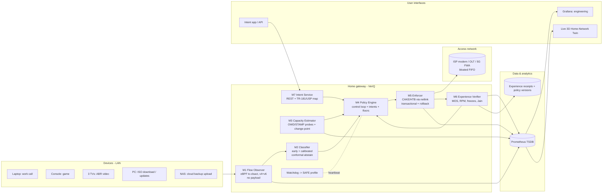

# 05 · Case 3 Solution Blueprint: **VeriQ**
### Experience-Verified, Intent-Aware QoS for the mixed-traffic home
*Case Study 3 (MCV): Adaptive QoS Engine for Mixed Home Broadband Traffic*

---

## 0. The idea in one paragraph

Every home-QoS product today *sets* a policy and hopes it helps. **VeriQ treats every QoS change as a hypothesis.**
1. It observes traffic without reading payloads.
2. It classifies flows with *calibrated* confidence and abstains when unsure.
3. It tracks the real link capacity as it moves.
4. It applies a candidate policy as a **canary**.
5. It then **proves** with statistics on real user-experience metrics (call quality score, video freezes, responsiveness under load, fairness) that the change helped.

If the proof fails, VeriQ **rolls back by itself**. Every decision leaves an **"experience receipt"**: the policy diff, the before/after metrics and the significance test. Temporary intents ("protect my work call for 45 min") are compiled into bounded, expiring, fairness-guarded policy deltas.

> One line for the panel: **"Other QoS engines guess. VeriQ verifies."**

---

## 1. Why the obvious solutions fail (what most teams will build)

| Generic approach | Why it fails in a real home |
|---|---|
| Static priority by port/DSCP | Most apps run on TCP/UDP 443 with QUIC/TLS; Windows and phones strip DSCP; ports say nothing about *what matters now* |
| "AI classifier + priority queue" | Prioritising without fixing the **queue location** does nothing. The bloated buffer sits in the ISP modem, not in your router. |
| Fixed shaper at 90% of plan speed | DOCSIS, 5G FWA and Wi-Fi capacity moves. Too high and the bloat returns; too low and bandwidth is wasted. |
| Strict priority | Starves bulk traffic; violates the case's no-starvation rule |
| Chatbot "prioritise my call" | The case explicitly says AI must improve a *measurable outcome*, not add a conversational interface |
| Ping graphs as "proof" | Ping ≠ experience. Panels want call quality, freezes, stalls and fairness. |

**Physics you must say out loud:** a home router can only reduce latency if it becomes the bottleneck. It must shape slightly below the true link capacity so the queue forms in *its* smart AQM (Active Queue Management) instead of the ISP's dumb FIFO buffer. Capacity estimation is therefore the heart of the problem, not a side feature.

---

## 2. Architecture (device → edge → network → data → analytics → UI)

**Control cycle:** Observe → Classify/Estimate → Decide → **Canary** → Verify → Commit or Roll back. It runs at 1–10 Hz on the gateway CPU; the packet path never leaves the kernel.

---

## 3. Modules: contracts (inputs, outputs, states, failure handling, success conditions)

The case requires modules that can be tested independently. Each one below is a separate process or library with its own tests.

### M1 · Flow Observer (eBPF datapath)
- **In:** packets at `tc clsact` ingress/egress on the LAN and WAN interfaces (IPv4 + IPv6).
- **Out:** per-flow feature records via a BPF ring buffer: 5-tuple; first-30-packet sequence of (size, direction, inter-arrival time); rates; burst on/off structure; DSCP/ECN, including ECT(1) for L4S; TCP handshake RTT; QUIC long-header presence (cleartext version field only).
- **Privacy ladder:** Tier 0 (default) is header + timing only. Tier 1 (household opt-in) adds local DNS names and DHCP device fingerprints. **Payload is never read.** Report accuracy per tier.
- **Failure handling:** if the map is full, the LRU evicts the oldest flows and a counter is exported. If the program fails to load, the system runs in SAFE profile and raises an alarm.
- **Success:** per-packet overhead measured with `bpf_stats_enabled`; zero packet drops attributable to the observer.

### M2 · Flow Classifier
- **Classes:** `REALTIME` (voice/video calls), `GAMING`, `STREAMING` (ABR video), `INTERACTIVE` (web/short flows), `BULK_DOWN`, `BULK_UP` (backup/updates), `UNKNOWN`.
- **Model:** an anytime classifier that decides after 5/10/20/30 packets. It uses gradient-boosted trees on statistical features plus a tiny 1D-CNN on the packet sequence, distilled to trees for the CPE.
- **Confidence:** temperature-scaled probabilities plus **split-conformal prediction sets** at 95% coverage. If the set is not a single class, the flow is **abstained** and gets best-effort treatment. Wrong confidence is worse than no confidence.
- **Correction loop:** the UI/API lets a user relabel a flow or device. This creates an override rule plus a labelled sample for retraining (active learning). Every correction is audit-logged.
- **Data:** your lab traffic (ground truth known), plus the public **CESNET-QUIC22** dataset (153M real QUIC flows, first-30-packet features; check its licence on Zenodo) to show cross-dataset generalisation.
- **Deterministic baseline:** port/protocol rules (e.g. STUN/TURN port ranges → REALTIME, TCP 443 → INTERACTIVE).
- **Success:** macro-F1, per-class recall, abstention rate, coverage; and **downstream** latency and quality-score impact versus the baseline.

### M3 · Link Capacity Estimator (upstream and downstream separately)
- **Signals:**
  - achieved throughput, backlog, drops and ECN marks from `tc -s` (netlink);
  - load-induced delay from active probes: UDP one-way delay (irtt-style) to reflectors, or STAMP (RFC 8762) / TWAMP-light where the ISP edge supports it;
  - passive TCP handshake RTTs from M1.
- **Method:** a state-space (Kalman-style) filter on capacity, plus **Bayesian Online Change-Point Detection** on delay baseline and delivery rate. A 100 → 20 Mbps step is detected in about a second instead of creeping down. Uncertainty σ is reported with the estimate.
- **Precision details that panels notice:**
  - **link-layer overhead compensation** (DOCSIS / PTM / Ethernet framing), because shaping on IP bytes alone misses the true wire rate;
  - **separate up/down estimators** (home uplinks are the worst bufferbloat offenders: cloud backups kill calls);
  - **reflector health scoring**, so a bad reflector cannot fake congestion.
- **Baselines:** a static shaper at 90% of plan speed, and a cake-autorate-style threshold controller.
- **Success:** tracking error after a step change, time-to-settle, overshoot, and steady-state utilisation.

### M4 · Policy Engine (the control loop)
- **In:** flow classes with confidence, capacity estimate ± σ, active intents, household rules.
- **Out:** a desired policy document (versioned; content-hash ID).
- **Policy content:**
  - shaper rate = μ − kσ, so uncertainty automatically buys safety margin;
  - CAKE `diffserv4` tins with per-host fairness (`dual-srchost`/`dual-dsthost`), so 3 TVs cannot starve a console;
  - class → tin mapping;
  - per-class **minimum floors** (anti-starvation);
  - intent boosts with caps.
- **Control law:** setpoint on added queuing delay (e.g. p95 ≤ 10 ms for REALTIME); bounded AIMD (additive increase, multiplicative decrease) with a change-point fast path; rate-of-change limiter and hysteresis so the policy does not flap.
- **States:** `INIT → LEARN_BASELINE → STEADY ⇄ ADAPTING → CANARY → (COMMIT | ROLLBACK) → STEADY`. Any invariant violation leads to `SAFE`.
- **Success:** policy changes/min in steady state, oscillation amplitude, starvation events (target 0).

### M5 · Enforcer (transactional)
- **How it applies policy:** via netlink (pyroute2) using `qdisc replace/change`. CAKE accepts live `change ... bandwidth X` without flushing queues. Classification sets `skb->priority` from eBPF, so packets are never rewritten and DSCP never leaks upstream.
- **Readback verification:** the applied state must equal the intended state. Otherwise it rolls back to the last-known-good version.
- **Watchdog (systemd):** if the controller heartbeat is lost, or any invariant is violated (rate ≤ 0, floor missing, config drift), it installs the **SAFE profile**: static CAKE at a conservative rate, or plain fq_codel. The case requires remediation that is "bounded, observable, reversible" and fails to a known safe state. This module is where that requirement is met.

### M6 · Experience Verifier (closed-loop quality of experience)
- **Per-class quality models:**
  - REALTIME: **ITU-T G.107 E-model** R-factor → MOS (Mean Opinion Score) from delay, jitter and loss; plus real **WebRTC `getStats()`** (`freezeCount`, `totalFreezesDuration`, `concealedSamples`, `jitterBufferDelay`) in the lab;
  - GAMING: p99 latency and jitter against the tick deadline;
  - STREAMING: throughput headroom against the bitrate ladder, plus real **dash.js rebuffer events** in the lab;
  - BULK: progress against its floor;
  - household: **Jain's fairness index** (weighted by intent).
- **Responsiveness under load:** periodic **RPM** per the IETF IPPM *Responsiveness under Working Conditions* draft (draft-09, July 2026), the same metric Apple's `networkQuality` reports. Optional ΔQ ("quality attenuation") reporting aligned with Broadband Forum **TR-452**.
- **Canary analysis:** compare the pre-change window with the canary window (e.g. 15 s each). Use bootstrap confidence intervals and Mann–Whitney U on p95 delay and MOS. COMMIT only if the change is better, or neutral when it was required; otherwise ROLLBACK.
- **Output: "experience receipt"** (JSON plus a UI card): policy diff, metric deltas with CIs, p-value, decision, and the reason in plain English.

### M7 · Intent Service
- **Intent model:** `{target: device | class | flow, goal: protect | prioritise | deprioritise | cap, ttl, guard: {min_floor_others}}`.
- **Compiler:** turns an intent into a policy delta with **TTL auto-expiry**. Conflicts resolve as safety > household rules > newest intent. Boosted share is capped (e.g. ≤ 60%) so everyone else keeps their floors.
- **Interfaces:** REST API + web UI. A data-model mapping to **TR-181**-style objects and **TR-369 (USP)** Set/Notify lets an operator push or audit intents fleet-wide. That is how VeriQ would live inside an RDK-B or prplOS gateway.
- Natural language is optional sugar, never the core.

### M8 · Telemetry, dashboards and the **live 3D Home-Network Twin**
- **Prometheus exporters** cover qdisc stats, flows, estimator and decisions; **Grafana** serves engineers.
- **3D twin** (React + three.js), fed live over WebSocket:
  - a house with real devices;
  - flows as particle streams coloured by class;
  - the WAN pipe's width equals estimated capacity;
  - queues as glass tanks whose water level is queuing delay (you *see* bufferbloat fill and drain);
  - intent badges, a latency "heartbeat" line, and a time-travel scrubber that replays any recorded experiment.

  It is driven by real telemetry, not animation. That is what makes it meaningful.

### M9 · Evidence Harness: "QoS Lab-in-a-box"
- **Topology:** Linux network namespaces with LAN clients, the VeriQ router, an ISP emulator (tbf with a deliberately *bloated* buffer, plus netem delay/loss and scheduled capacity steps) and servers. IPv4 and IPv6 are both enabled.
- **Scenario DSL (YAML):** timeline events such as `t=30 start iso_download`, `t=60 wan_down 100→20`, `t=90 intent protect(laptop, 45m)`.
- **Real applications:**
  - WebRTC calls between headless Chromium instances (fake camera fed by an ffmpeg-generated test pattern, so there are no copyright issues);
  - dash.js playing locally encoded multi-bitrate DASH;
  - tick-based synthetic game traffic;
  - HTTP and iperf3 bulk traffic in both directions.
- **Measurement tools:** Flent RRUL, irtt, iperf3, goresponsiveness (RPM).
- **Five arms for every scenario:** **(A)** FIFO (stock router), **(B)** fq_codel without a shaper, **(C)** static CAKE (OpenWrt SQM best practice), **(D)** cake-autorate-style, **(E) VeriQ**. Run ≥10 repetitions each and report medians with 95% bootstrap CIs.
- **One command** resets, runs, collects and generates an **HTML/PDF evidence report**. The report includes an environment fingerprint (kernel, tool versions, config hashes) so evaluators can reproduce it.
- **CI:** GitHub Actions (Ubuntu runners ship CAKE/fq_codel/netem) runs a smoke scenario on every push. This is QoS regression testing, the way industry does it.

---

## 4. Test scenarios (the case's three, plus ones that show depth)

| # | Scenario | Pass condition (targets, to be measured) |
|---|---|---|
| S1 | ISO download starts during a video call | Call MOS stays ≥ 4.0; WebRTC freezes = 0; added delay p95 ≤ 10 ms; download still gets ≥ 85% of leftover capacity |
| S2 | WAN drops 100 → 20 Mbps mid-call | Change-point detected and shaper settled in < 2 s; no latency spike > 50 ms lasting > 1 s; no oscillation afterwards |
| S3 | 3 TVs streaming + gaming console | Game p99 latency ≤ 20 ms added; TVs: zero rebuffer events at a sustainable bitrate; Jain index across hosts ≥ 0.9 |
| S4 | Cloud backup upload during a call (uplink bloat) | Same as S1, on the upstream |
| S5 | Intent "protect laptop call 45 min" while others are busy | Call protected; others never fall below floors; intent auto-expires and reverts on time |
| S6 | Misclassification injected | Low-confidence flow abstained; user correction applied < 1 s; no harm in the canary |
| S7 | Chaos: kill the controller / corrupt the policy | Watchdog reaches SAFE profile in < 1 s; traffic keeps flowing; alarm raised |
| S8 | IPv6-only client | Identical behaviour to IPv4 |

## 5. AI vs deterministic baseline (required by the case)

| Decision | Deterministic baseline | VeriQ AI component | Measured outcome |
|---|---|---|---|
| What is this flow? | Port/protocol rules | Calibrated early classifier with abstention | F1 / coverage **and** call MOS, game p99 under S1/S3 |
| How fast is the link? | Static 90% shaper; threshold controller | Change-point + state-space estimator | Settle time, overshoot, utilisation, latency spikes in S2 |
| Did the policy help? | None (fire-and-forget) | Statistical canary verification | Bad-policy rollbacks caught; time in degraded state |

If the AI does **not** beat the baseline somewhere, say so on the slide. Honesty on one negative result buys enormous credibility for the positive ones.

## 6. Precision, safety and honesty

**"No drawbacks" is not a claim any engineer will believe, and the case explicitly asks for a known-limitations section.** What impresses a panel is quantified precision plus safety properties plus honest limits.

**Safety properties (enforced by code and tested):**
1. No class rate is ever 0, so there is no starvation.
2. Every applied policy is read back and versioned.
3. Any failure leads to the SAFE profile within 1 s.
4. Intents always expire.
5. Payload is never read.
6. A low-confidence classification never increases a flow's priority.

**Known limitations (state them proactively):**
1. Shaping below capacity costs a few % of throughput (the "bandwidth tax"). Adaptive estimation shrinks it but never eliminates it.
2. Download shaping is indirect: it relies on TCP/QUIC reacting to drops or ECN, so unresponsive UDP floods can only be partly contained.
3. Payload-free classification is probabilistic. Multiplexed QUIC connections blur classes, which is why VeriQ abstains and accepts corrections.
4. When Wi-Fi is the bottleneck, control needs driver support (mac80211 Airtime Queue Limits / airtime fairness, per-station airtime weights). This is hardware-dependent and Phase 2.
5. CAKE is single-threaded per qdisc, so low-end CPE CPUs top out below multi-gig. The scale path is EDT (earliest-departure-time) shaping with eBPF + `sch_fq` on multi-queue NICs, as in the Cilium Bandwidth Manager.
6. Emulated WAN ≠ a real DOCSIS/PON/5G scheduler. Validate on the physical kit and a real ISP line, and label all emulation clearly (the case requires this).

## 7. Industry-grade scaling path

| Level | Prototype | Production path |
|---|---|---|
| Datapath | eBPF classifier + CAKE/HTB | Same on ≤1 Gbps CPE; **EDT + eBPF + sch_fq** for multi-gig XGS-PON; **DualPI2 / L4S** for ECT(1) flows (mainline since Linux 6.17) |
| Device | Linux laptop netns lab; Raspberry Pi 5 router | RDK-B component / OpenWrt-prplOS package; Yocto recipe; ARM A53/A55-class CPU budget measured |
| Management | REST API | TR-181 data-model extension + **TR-369 USP** agent for operator fleet control |
| Fleet learning | Offline retraining | Federated classifier updates (no flow data leaves homes); fleet canary rollout 1% → 10% → 100% with aggregated experience receipts |
| Operator fit | — | Home-edge closed loop that feeds an operator's intent-based autonomous-network platform (Tata Elxsi's **NEURON** is intent-based) |

## 8. Tech stack (all open source; record licences in `LICENSES.md`)

| Layer | Choice |
|---|---|
| Datapath | Linux `tc` (CAKE, HTB, fq_codel, netem, tbf), eBPF (libbpf CO-RE, C) on `clsact` |
| Control plane | Python 3.12 (asyncio) with pyroute2 netlink; optionally Go for the CPE build |
| ML | LightGBM / scikit-learn, PyTorch (tiny 1D-CNN), MAPIE or own split-conformal code; ONNX/treelite for CPE |
| Estimation | NumPy/SciPy: Kalman filter + BOCPD (Bayesian Online Change-Point Detection, ~100 lines) |
| Measurement | Flent, irtt, iperf3, goresponsiveness, Playwright + Chromium (WebRTC, dash.js), ffmpeg |
| Data | Prometheus + Grafana; SQLite for receipts and policy versions |
| UI | React + TypeScript, three.js / react-three-fiber (3D twin), FastAPI WebSocket |
| Ops | systemd watchdog units, Docker for tooling, GitHub Actions CI, reproducible scenario runner |

Watch licences: Flent is GPL-3 and irtt GPL-2. Use them as external tools, not linked code, and document this. Submissions become Tata Elxsi IP, so keep VeriQ's core permissive (Apache-2.0/MIT).

## 9. Coverage of the case's acceptance evidence

| Required output | VeriQ |
|---|---|
| Traffic-class and link-capacity estimator | M2 + M3 |
| Dynamic QoS policy engine and enforcement | M4 + M5 |
| Dashboard: latency, jitter, loss, throughput, queue depth, fairness | M8 Grafana + 3D twin |
| Automated baseline-vs-optimised experiments | M9 five-arm harness |
| API/UI for temporary intent | M7 |
| Architecture diagram: device, edge, network, data, analytics, UI | §2 |
| Setup guide with exact versions and commands | `lab/README` + environment fingerprint |
| Scripted demo: reset → condition → evidence → report | M9 runner |
| Known limitations | §6 |
| Licences, no secrets, emulation labelled | `LICENSES.md`, `.env.example` with fictitious values, report headers |

## 10. References
- CAKE / SQM / bufferbloat: <https://www.bufferbloat.net/projects/codel/wiki/Cake/>
- cake-autorate (variable-rate CAKE): <https://github.com/lynxthecat/cake-autorate>
- qosify (OpenWrt eBPF + CAKE DSCP classifier): <https://git-03.infra.openwrt.org/project/qosify/tree/README>
- IETF Responsiveness under Working Conditions (draft-09, Jul 2026): <https://www.ietf.org/archive/id/draft-ietf-ippm-responsiveness-09.html>
- Comcast L4S deployment draft (Apr 2026): <https://www.ietf.org/ietf-ftp/internet-drafts/draft-livingood-low-latency-deployment-16.html>
- DualPI2 mainlined in Linux 6.17 (L4S/Prague update, IETF 124): <https://datatracker.ietf.org/meeting/124/materials/slides-124-iccrg-l4s-and-prague-update-00>
- Broadband Forum TR-452 Quality Attenuation (via IETF liaison): <https://datatracker.ietf.org/liaison/1802/>
- WebRTC inbound-rtp stats (freezeCount etc.): <https://developer.mozilla.org/en-US/docs/Web/API/RTCInboundRtpStreamStats>
- CESNET-QUIC22 dataset: <https://www.ncbi.nlm.nih.gov/pmc/articles/PMC9851865/>, Zenodo DOI 10.5281/zenodo.7409923
- Federated QUIC classification (2025): <https://arxiv.org/pdf/2509.09997>
- Cilium Bandwidth Manager (EDT + eBPF + FQ): <https://docs.cilium.io/en/stable/network/kubernetes/bandwidth-manager/>
- mac80211 Airtime Queue Limits: <https://lwn.net/Articles/804940/>
- Tata Elxsi RDK-B on Qualcomm 5G FWA (QoS among operator features): <https://www.voicendata.com/news/tata-elxsi-integrates-rdk-b-with-qualcomms-5g-fwa-gen-3-platform-7092013>
- Tata Elxsi NEURON (intent-based autonomous networks): <https://www.tataelxsi.com/platforms/neuron-autonomous-network-platform>
