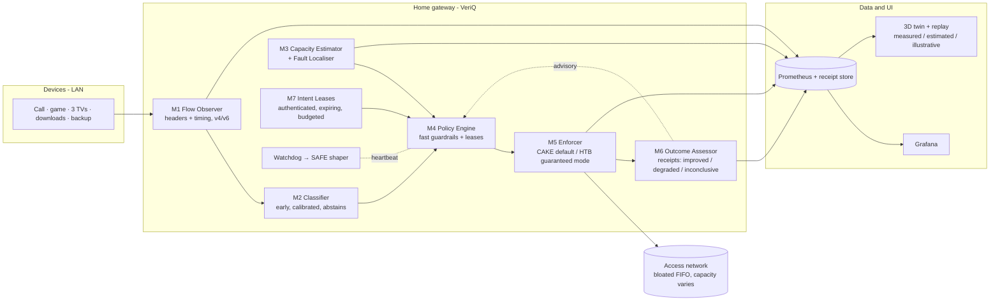

# 05 · Case 3 Solution Blueprint: **VeriQ** (v2)
### Intent-aware home QoS with measurable outcomes, bounded adaptation and explainable recovery
*Case Study 3 (MCV): Adaptive QoS Engine for Mixed Home Broadband Traffic*

> **v2 changes (after external review).** We merged the strongest engineering safeguards of the "IntentGuard" proposal into VeriQ and narrowed every claim we cannot prove. Main changes:
> 1. Outcome checks now return **improved / degraded / inconclusive**, and causal claims come only from controlled repeated experiments.
> 2. **Real bandwidth floors** come from an HTB hierarchy; CAKE tins alone only give priority sharing.
> 3. **Fault localisation** runs before any action.
> 4. Conformal prediction is reported correctly: coverage, selective accuracy and abstention.
> 5. The quality score (MOS) is labelled *estimated*; endpoint freeze and rebuffer counts lead.
> 6. The privacy statement is precise.
> 7. Baselines are the **real, tuned** tools, plus ablations.
> 8. A scope split separates the **MVP spine** from **stretch tracks**.
>
> Everything below is a **design with targets, not measured results**, until the lab produces them.

---

## 0. The idea in one paragraph

VeriQ is a home-gateway QoS controller with **three loops running at different speeds**:
1. **Fast guardrails** (sub-second) track link capacity and keep queuing delay bounded.
2. A **medium-speed outcome check** (tens of seconds) attaches an *experience receipt* to every adaptation. Each receipt says whether the change **improved**, **degraded** or was **inconclusive** for real application metrics, and explains why.
3. **Slow, controlled experiments** (lab, repeated and randomised) are the *only* source of causal performance claims.

Before acting, VeriQ **localises the fault**: our own queue, the WAN capacity, the remote path, Wi-Fi, or a misleading measurement. It then uses the action that fits that fault. Temporary user intents become **authenticated, expiring leases** paid from an explicit **promotion budget**, enforced by real guaranteed rates.

> Pitch line: **"VeriQ adapts, measures, and explains: every decision comes with evidence, and every claim with a method."**

---

## 1. Why the obvious solutions fail

| Generic approach | Why it fails in a real home |
|---|---|
| Static priority by port/DSCP | Most apps use QUIC/TLS on 443; many endpoints don't set DSCP; ports don't tell you what matters *now* |
| "AI classifier + priority queue" | Prioritising does nothing if the queue sits in the ISP modem. The gateway must become the bottleneck by shaping just below the true capacity. |
| Fixed shaper at 90% of plan speed | Capacity moves (DOCSIS, 5G FWA). Too high and the bloat returns; too low and bandwidth is wasted. |
| Strict priority | Starves bulk traffic, which the case forbids |
| Chatbot intents | The case requires AI to improve a measurable outcome, not to add chat |

**Day-0 evidence:** our lab (`lab/quickstart_bufferbloat.sh`, emulated 20/5 Mbit with a 300 ms ISP buffer) measured **266 ms p95 added delay on upload with a stock FIFO**. **fq_codel without a shaper is not a fix**: it cannot touch a queue that lives upstream.

---

## 2. Architecture

---

## 3. Modules: contracts

### M1 · Flow Observer
- **In:** packets on the LAN/WAN interfaces (IPv4 + IPv6).
- **Out:** per-flow records: 5-tuple; first-N packet sizes, directions and inter-arrival times; rates; burst structure; DSCP/ECN bits; TCP handshake RTT.
- **Implementation:** **MVP** uses userspace AF_PACKET capture of headers only, to get features working fast. **Stretch** ports it to eBPF on `tc clsact` for CPU efficiency, and keeps the port only if CPU measurements justify it.
- **Precise privacy statement:** VeriQ **does not inspect the payload of forwarded traffic** and does not decrypt anything.
  - Tier 0 (default) uses headers and timing only.
  - Tier 1 (household opt-in, local only) additionally uses **the gateway's own DNS and DHCP service records** for device and service hints. That is information the gateway already holds as a service provider, and the UI discloses it.
  - Accuracy is reported **per tier**.
- **Failure handling:** feature buffer overflow → oldest flows evicted and counted.

### M2 · Flow Classifier
- **Classes:** `REALTIME`, `GAMING`, `STREAMING`, `INTERACTIVE`, `BULK_DOWN`, `BULK_UP`, `UNKNOWN`.
- **Model:** a **small calibrated gradient-boosted model first**, evaluated after 5/10/20/30 packets (early classification). Add a 1D-CNN (and distillation) **only if an ablation shows it earns its cost**.
- **Abstention:** split-conformal prediction sets. Act only on **single-class sets**; anything else → `UNKNOWN` (best effort, never promoted).
- **Reported separately, never conflated:**
  1. empirical **set coverage** on held-out data (the conformal guarantee is about sets, under exchangeability);
  2. **selective accuracy**, i.e. accuracy of the single-class predictions we act on;
  3. **abstention rate**;
  4. per-class recall;
  5. all of the above **under shift**: different days, app versions and household mixes;
  6. how the earliest confident prefix was selected (on validation data, never on test).
- **Data:** independently labelled **household workloads** from our lab apps are the primary data. **CESNET-QUIC22** (153M QUIC flows, 102 service classes) is a *secondary* benchmark, with a documented service → category mapping and feature-compatibility notes. Its service labels do not directly say whether traffic needs interactive protection.
- **Correction loop:** a user relabel becomes an override rule plus a labelled sample (audit-logged).
- **Baseline:** port/protocol rules.

### M3 · Capacity Estimator + **Fault Localiser**
**Signals:**
- our own qdisc backlog, drops and ECN marks;
- throughput;
- one-way-delay probes to **two tiers of reflectors**: the ISP first hop or near reflector, and several far reflectors;
- passive TCP handshake RTT;
- Wi-Fi station stats where available (retries, MCS/rate, airtime).

**Estimation:** state-space filter on capacity, plus change-point detection on delay and delivery rate. Output: capacity μ ± σ per direction.

**Fault localisation runs before any action:**

| Evidence | Diagnosis | Action |
|---|---|---|
| Our queue grows, external delay flat | Gateway is the bottleneck (healthy) | Nothing; the AQM handles it |
| Our queue empty, near **and** far delay rise | **WAN capacity dropped** | Cut the shaper (fast path), re-probe upward slowly |
| Only far reflectors rise, near hop fine | **Remote path** congestion | **Hold the shaper**; cutting it would waste capacity |
| WAN fine, Wi-Fi retries/airtime spike for a station | **Wi-Fi** bottleneck | Don't touch the WAN shaper; flag it (Phase 2: airtime weights) |
| One reflector disagrees with the others | **Misleading measurement** | Down-weight it via reflector health voting; no action |
| Contradictory or low-confidence evidence | **Unknown** | Conservative hold + alert |

Every diagnosis carries a confidence, and it is evaluated in the lab against the emulator's **ground truth**.

### M4 · Policy Engine (fast guardrails)
- Shaper rate = μ − kσ, so uncertainty buys margin.
- Bounded AIMD with a change-point fast path for drops; slow upward probing.
- Rate-of-change limits and hysteresis on class changes.
- **States:** `INIT → LEARN → STEADY ⇄ ADAPTING → STEADY`. Invariant violation → `SAFE`.
- **Decisions never depend on the slow outcome check to stay safe.** Guardrails act immediately; receipts explain afterwards.

### M5 · Enforcer: two modes with honest semantics
1. **Default mode: CAKE** (`diffserv4`, per-host fairness, overhead compensation). This gives **bounded preferential treatment** (priority sharing with tin thresholds), **not hard minimum rates**. Fairness is *measured*.
2. **Guaranteed mode: HTB hierarchy** under the shaper: one class per traffic class or lease, with `rate` = guaranteed floor and `ceil` = shaper rate, and fq_codel leaves. This is what gives **real minimum rates** while intents are active. Admission control rejects a lease that would push the sum of guaranteed rates over **shaper × (1 − reserve)**.

**Apply semantics (narrowed):**
- Multi-step netlink updates are **not atomic**. Updates are **ordered so every intermediate state is safe**: change rates before removing classes, add filters after classes exist.
- Each update is versioned, read back and **compensated** on mismatch.

**DSCP:**
- VeriQ classification sets `skb->priority` or marks and **does not rewrite DSCP**.
- DSCP that apps set themselves passes upstream **unless `wash` is enabled**, which is configurable and documented.

**SAFE profile:** a static conservative CAKE shaper at last-known-good capacity minus margin. This is not plain fq_codel, which cannot fix an upstream bottleneck. Fallback time is a **measured target**, not a promise.

### M6 · Outcome Assessor ("experience receipts")
**Metrics (in priority order):**
1. **Endpoint-measured:** WebRTC `freezeCount`, `totalFreezesDuration`, `concealedSamples`, jitter-buffer delay; DASH rebuffer events and bitrate switches.
2. **Network-measured:** queuing delay percentiles, loss, goodput per class and host, **progress per class** (starvation is measured as zero useful progress over a window, not inferred from config).
3. **Modelled:** *estimated* audio quality via the ITU-T G.107 E-model, which is a planning model. The codec and impairment assumptions are documented and the result is always labelled "estimated".
4. **RPM** (IETF responsiveness draft-09, a work in progress) is run as a **scheduled** benchmark, never as a hidden load during someone's call.

**Receipt logic (operational, not causal):**
- Compare windows only **within a stable regime**. If a capacity change-point, demand shift or another policy change falls inside the window, the result is **inconclusive**, never "degraded".
- Use block bootstrap (observations are autocorrelated) and minimum sample counts.
- On **degraded**, the rollback **reverts the policy delta re-derived for current conditions**. It never restores a stale absolute rate from a different capacity regime.
- Receipts are **advisory**. Safety comes from the guardrails, not from statistics.

### M7 · Intent Leases
- A lease looks like `{who (authenticated), target device/class, goal, ttl, budget_share}`.
- A **promotion budget** sets the maximum total guaranteed share all leases may hold, implemented as HTB guaranteed rates. Admission control decides grant / partial grant / deny, and gives the reason.
- Leases always expire; renewing requires re-authentication.
- Conflicts resolve as safety > household rules > priority > age.
- **Interfaces:** REST + UI. A TR-181-style data-model / TR-369 USP mapping is **designed, not implemented** in the MVP.

### M8 · Telemetry, Grafana and the **3D twin with replay**
- Every visual element carries one of **three encodings**:
  - **Measured** (solid): local queue counters, throughput, endpoint stats.
  - **Estimated** (outlined + confidence band): capacity, inferred upstream congestion, diagnosis.
  - **Illustrative** (particles, house graphics): labelled as such.
- The **ISP queue tank is "inferred"** (hatched), because a gateway cannot observe it. In the lab, the emulator's **true** queue is shown beside the inferred one. That makes estimator accuracy itself visible.
- **Replay scrubber:** select the moment capacity collapsed, and call metrics, queues, estimator confidence, diagnosis, applied config and the receipt move together.

### M9 · Evidence Harness
- **netns lab + scenario YAML:** timed capacity steps, traffic starts and **fault injections** (capacity drop, remote-path delay, lying reflector, Wi-Fi-like station impairment, controller crash).
- **Real apps:** WebRTC between headless Chromium instances (ffmpeg test-pattern media), dash.js with locally encoded DASH, tick-based game traffic, iperf3/HTTP bulk in both directions.
- **Arms (real, tuned implementations):**
  1. stock FIFO;
  2. fq_codel;
  3. OpenWrt-style **SQM CAKE** (static, tuned);
  4. **cake-autorate v3.2** (the actual project, tuned per its docs);
  5. VeriQ.
- **Ablations:** VeriQ without the classifier, without fault localisation, and without the HTB guaranteed mode. **This proves VeriQ is more than a CAKE wrapper, or tells us honestly where it isn't.**
- **Statistics for claims:** ≥10 runs per arm per scenario in **randomised order**; medians with bootstrap 95% CIs; Holm correction across metrics; an environment fingerprint on every report.

---

## 4. Scenarios and targets (targets are plans, not results)

| # | Scenario | Target |
|---|---|---|
| S1 | ISO download during a WebRTC call | 0 freezes in VeriQ arm; added delay p95 ≤ 10 ms; bulk keeps ≥ 85% of leftover |
| S2 | WAN 100 → 20 Mbps mid-call | Diagnosed as WAN drop; shaper settles < 2 s; no oscillation |
| S3 | 3 TVs + gaming | Game p99 added ≤ 20 ms; 0 rebuffers at a sustainable bitrate; host fairness (Jain) ≥ 0.9 |
| S4 | Backup upload during a call | As S1, upstream |
| S5 | Lease "protect laptop 45 min" | Guaranteed rate honoured; others' progress > 0 throughout; expiry on time |
| S6 | Remote-path delay injected | Diagnosed as remote; **shaper held** (no false cut) |
| S7 | Lying reflector | Down-weighted; no action |
| S8 | Controller crash | SAFE shaper engaged; time-to-safe measured |
| S9 | IPv6-only client | Same behaviour as IPv4 |

**Judge-chosen faults (finale):** the judge picks a fault from a menu on the physical kit. VeriQ responds **from telemetry only**, never from a hidden scenario label.

## 5. MVP spine vs stretch tracks (scope discipline)

**MVP spine (must work end-to-end by 13 Dec):**
1. netns lab + scenario runner + real baselines;
2. userspace observer + small calibrated classifier with abstention;
3. capacity estimator + fault localiser (WAN / remote / own queue / bad reflector);
4. CAKE default + HTB guaranteed mode + leases with budget;
5. receipts (improved / degraded / inconclusive);
6. WebRTC + DASH harness;
7. Grafana + recorded replay;
8. the five-arm + ablation evaluation.

**Stretch, in priority order:**
1. 3D twin (replay first, live second);
2. physical Pi 5 kit with fault buttons;
3. eBPF observer;
4. conformal sets on CESNET-QUIC22;
5. Wi-Fi airtime control;
6. TR-181/USP agent;
7. L4S/DualPI2;
8. EDT/multi-queue scaling study;
9. TLA+ model of the lease/rollback protocol.

## 6. Guarantees we claim and limits we state

**Claimed and tested properties:**
1. Payload of forwarded traffic is never inspected.
2. Abstained flows are never promoted.
3. Leases always expire.
4. Guaranteed-mode floors are enforced by HTB `rate`, and **progress is measured**.
5. Every applied config is versioned and read back.
6. A watchdog engages the SAFE shaper on heartbeat loss, with time-to-safe measured.

**Known limitations:**
1. Shaping below capacity costs a few % of throughput.
2. Download shaping relies on senders responding to drops or ECN; unresponsive UDP can only be partly contained.
3. Payload-free classification is probabilistic; multiplexed QUIC blurs classes.
4. Wi-Fi diagnosis needs driver statistics, and Wi-Fi control needs driver support.
5. CAKE is single-threaded; multi-gig CPE scaling is an open research track. EDT-based approaches such as the Cilium Bandwidth Manager are Kubernetes egress tools with *different semantics*, not a drop-in replacement.
6. The ISP queue is inferred, never observed.
7. Emulated WAN ≠ real DOCSIS/PON/5G schedulers, so all emulation is labelled.
8. Receipts are operational evidence; causal claims come only from controlled experiments.
9. **VeriQ must prove through ablations that it adds value beyond tuned CAKE and cake-autorate.**

## 7. Industry path (designed, not built)
- **Packaging:** RDK-B component / OpenWrt package; a TR-181 data-model extension plus a TR-369 USP agent for fleet management.
- **Fleet operation:** staged rollout of policy versions with aggregated receipts.
- **Learning:** federated classifier updates.
- **Operator integration:** thematic fit with intent-based, closed-loop operations platforms such as Tata Elxsi's NEURON. Compatibility is not established.

## 8. Tech stack
| Layer | Choice |
|---|---|
| Datapath | Linux `tc`: CAKE, HTB, fq_codel; netem/tbf in the lab; eBPF `clsact` (stretch) |
| Control | Python 3.12 asyncio + pyroute2 |
| ML | scikit-learn / LightGBM, own split-conformal code (or MAPIE); PyTorch only if the ablation justifies it |
| Measurement | Playwright + Chromium (WebRTC, dash.js), ffmpeg, iperf3, irtt, Flent, goresponsiveness |
| Data / UI | Prometheus, Grafana, SQLite receipts, FastAPI WebSocket, React + react-three-fiber |
| Baselines | OpenWrt SQM scripts, cake-autorate v3.2 |

Licences: Flent (GPL-3), irtt (GPL-2) and cake-autorate (GPL) are run as external tools and documented in `LICENSES.md`. The VeriQ core stays Apache-2.0/MIT, because submissions become Tata Elxsi IP.

## 9. References
- tc-cake (priority-sharing tins, overhead, wash): <https://manpages.debian.org/unstable/iproute2/tc-cake.8.en.html>
- cake-autorate: <https://github.com/lynxthecat/cake-autorate>
- IETF Responsiveness under Working Conditions (draft-09): <https://www.ietf.org/archive/id/draft-ietf-ippm-responsiveness-09.html>
- ITU-T G.107 E-model: <https://www.itu.int/ITU-T/recommendations/rec.aspx?rec=12505>
- Conformal prediction primer (coverage semantics): <https://arxiv.org/abs/2107.07511>
- CESNET DataZoo datasets: <https://cesnet.github.io/cesnet-datazoo/datasets_overview/>
- Mann–Whitney assumptions (independence), SciPy: <https://docs.scipy.org/doc/scipy/reference/generated/scipy.stats.mannwhitneyu.html>
- WebRTC inbound-rtp stats: <https://developer.mozilla.org/en-US/docs/Web/API/RTCInboundRtpStreamStats>
- Cilium Bandwidth Manager (Kubernetes EDT): <https://docs.cilium.io/en/stable/network/kubernetes/bandwidth-manager/>
- Tata Elxsi NEURON: <https://www.tataelxsi.com/platforms/neuron-autonomous-network-platform>
